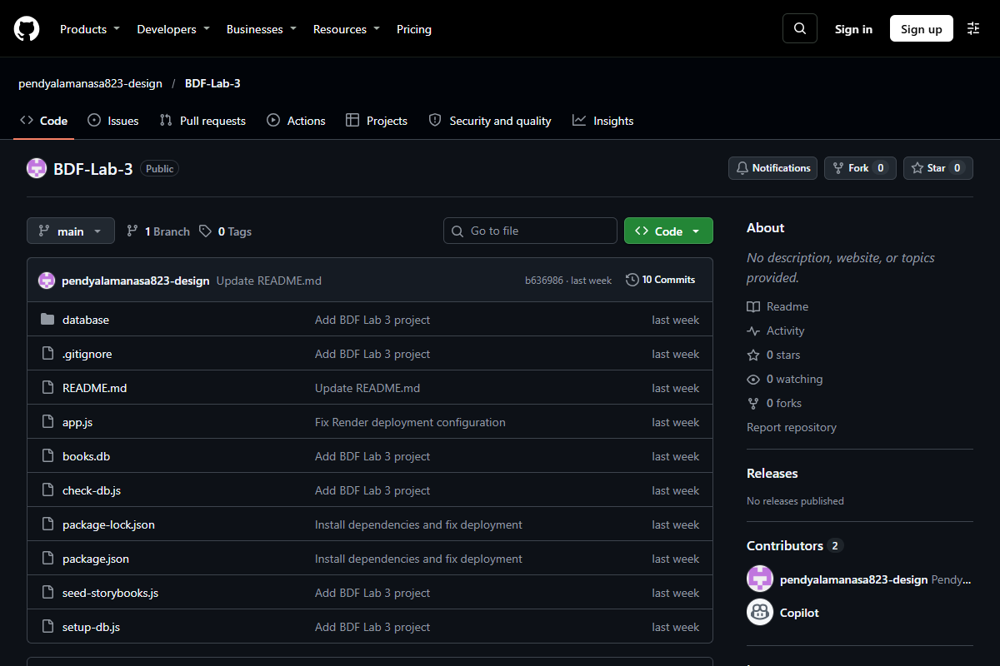
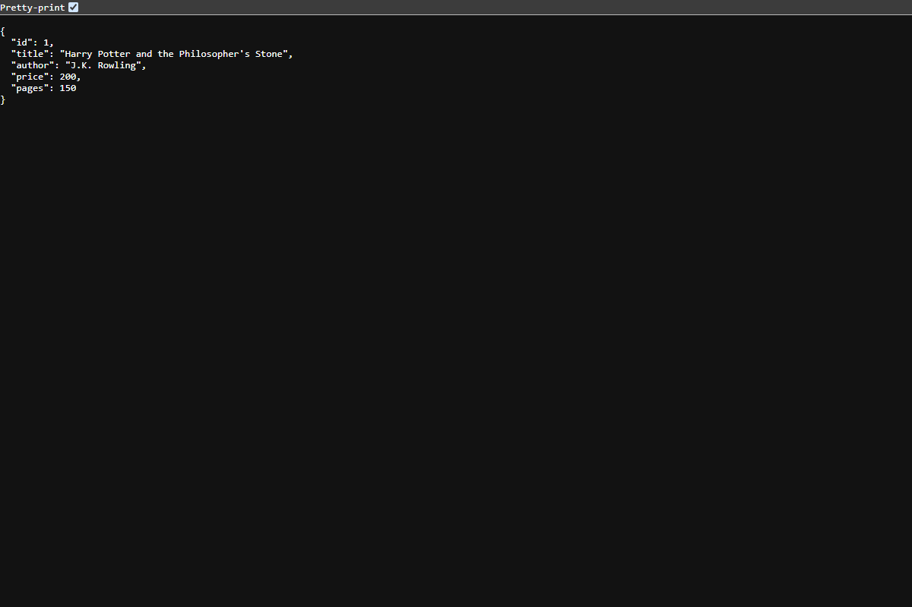
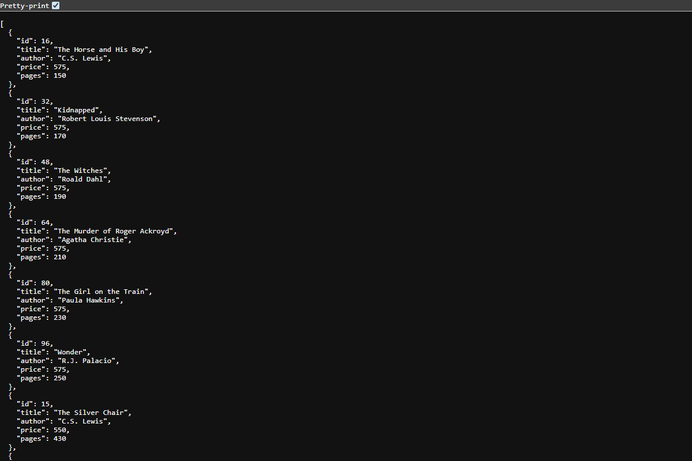
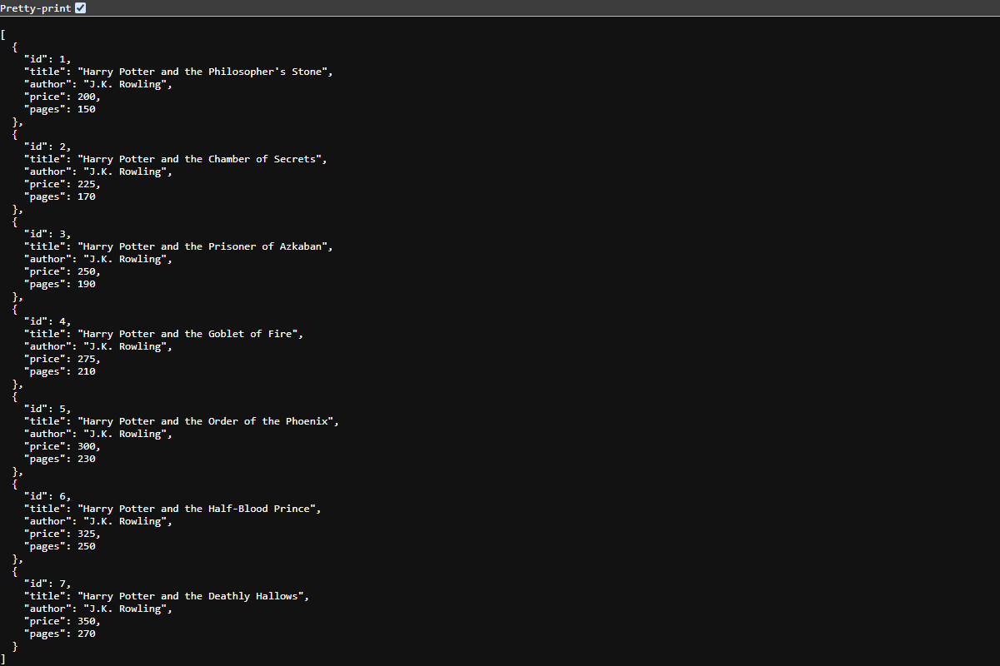
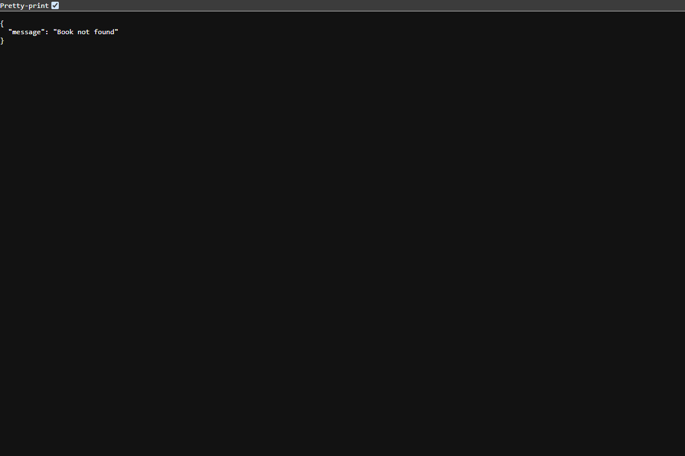

# Backend Development Fundamentals – Lab 3
## REST API Development using Node.js, Express.js and SQLite

### Student Details

- **Name:** Pendyala Manasa
- **Registration Number:** 252U1R1191
- **Section:** CSE-2D
- **Course:** Backend Development Fundamentals-3

---

## Live Application
- **Live Application URL:** https://bdf-lab-3-er43.onrender.com/
- **GitHub Repository:** https://github.com/pendyalamanasa823-design/BDF-Lab-3

---

## 1. Project Description

This project focuses on developing a RESTful API for managing a collection of books using Node.js, Express.js and SQLite.

The application supports CRUD operations (Create, Read, Update and Delete), query parameters, input validation and error handling.

It also demonstrates how to retrieve books using search functionality, sorting, pagination and price-range filtering.

---

## 2. Technologies Used

- **Node.js:** JavaScript runtime environment.
- **Express.js:** Framework for building REST APIs.
- **SQLite:** Lightweight relational database.
- **sqlite3:** SQLite database driver.
- **sqlite:** Promise-based interface for SQLite.
- **Postman:** API testing and validation.
- **Git and GitHub:** Version control and source-code management.
- **Render:** Application deployment platform.

---

## 3. Project Structure

```text
BDF-Lab-3/
│
├── app.js
├── package.json
├── package-lock.json
├── README.md
│
├── database/
│   └── books.db
│
├── screenshots/
│   ├── 01_github_repository.png
│   ├── 02_api_root_welcome.png
│   ├── 03_get_all_books.png
│   ├── 04_get_single_book_by_id.png
│   ├── 05_search_filter_the.png
│   ├── 06_sort_order_by_price_desc.png
│   ├── 07_pagination_limit_10_offset_0.png
│   ├── 08_price_range_filtering.png
│   ├── 09_combined_search_sort_pagination.png
│   └── 10_error_handling_book_not_found.png
│
├── setup-db.js
├── seed-storybooks.js
└── check-db.js
```

---

## 4. Installation and Setup

### Step 1: Clone the Repository

```bash
git clone https://github.com/pendyalamanasa823-design/BDF-Lab-3.git
```

### Step 2: Navigate to the Project Folder

```bash
cd BDF-Lab-3
```

### Step 3: Install Dependencies

```bash
npm install
```

### Step 4: Start the Application

```bash
npm start
```

The application runs locally at:

```text
http://localhost:3000/
```

---

## 5. Database Structure

The project uses an SQLite database named `books.db`.

The `book` table contains the following columns:

| Column | Data Type | Description |
|---|---|---|
| id | INTEGER | Primary key with auto-increment |
| title | TEXT | Book title |
| author | TEXT | Book author |
| price | INTEGER | Book price |
| pages | INTEGER | Number of pages |

The database is initialized and populated using the database setup and seed scripts (`setup-db.js`, `seed-storybooks.js`).

---

## 6. API Endpoints

### A. GET – Retrieve All Books
Retrieves the list of books from the database with support for filtering, sorting, and pagination.

- **HTTP Method:** `GET`
- **Route:** `/books/`
- **Supported Query Parameters:**

| Parameter | Description | Default |
|---|---|---|
| `search_q` | Search books by partial title matching (SQL `LIKE`) | `""` |
| `order_by` | Sort records using a selected field (`id`, `title`, `author`, `price`) | `"id"` |
| `order` | Sort order: `ASC` or `DESC` | `"ASC"` |
| `limit` | Maximum number of records to return | `500` |
| `offset` | Number of records to skip | `0` |
| `min_price` | Minimum book price filter | `undefined` |
| `max_price` | Maximum book price filter | `undefined` |

### B. GET – Retrieve a Single Book by ID
Retrieves details of a specific book by its primary key ID.

- **HTTP Method:** `GET`
- **Route:** `/books/:bookId/`
- **Success Response:** `200 OK` with book JSON object.
- **Error Response:** `404 Not Found` if the book ID does not exist.

### C. POST – Add a New Book
Creates and inserts a new book record into the SQLite database.

- **HTTP Method:** `POST`
- **Route:** `/books/`
- **Request Body (JSON):**
```json
{
  "title": "The Hobbit",
  "author": "J.R.R. Tolkien",
  "price": 375,
  "pages": 290
}
```
- **Success Response:** `201 Created` with `{ "message": "Book added successfully", "bookId": <id> }`

### D. PUT – Update an Existing Book
Updates the details of an existing book by its ID.

- **HTTP Method:** `PUT`
- **Route:** `/books/:bookId/`
- **Request Body (JSON):**
```json
{
  "title": "The Alchemist - Updated",
  "author": "Paulo Coelho",
  "price": 300,
  "pages": 220
}
```
- **Success Response:** `200 OK` with `{ "message": "Book updated successfully" }`
- **Error Response:** `404 Not Found` if the book ID does not exist.

### E. DELETE – Delete a Book
Deletes a book record from the database using its ID.

- **HTTP Method:** `DELETE`
- **Route:** `/books/:bookId/`
- **Success Response:** `200 OK` with `{ "message": "Book deleted successfully" }`
- **Error Response:** `404 Not Found` if the book ID does not exist.

---

## 7. Link Navigation, Screenshots & Endpoint Verification

All live endpoints and repository links were navigated in a web browser, tested, and captured below:

### 1. GitHub Repository
- **URL:** [https://github.com/pendyalamanasa823-design/BDF-Lab-3](https://github.com/pendyalamanasa823-design/BDF-Lab-3)
- **Description:** The official GitHub repository hosting the complete source code of the project. It shows all project files (`app.js`, `package.json`, `setup-db.js`, `seed-storybooks.js`, `check-db.js`, database schema files, and documentation), commit history, and the branch structure.



---

### 2. Live Application Root Endpoint (Welcome Message)
- **URL:** [https://bdf-lab-3-er43.onrender.com/](https://bdf-lab-3-er43.onrender.com/)
- **HTTP Method:** `GET`
- **Status Code:** `200 OK`
- **Description:** The root endpoint of the deployed application on Render. Navigating to this URL verifies that the Node.js/Express server is active and running, returning the welcome response `"Welcome to Books API"`.


---

### 3. Retrieve All Books (`/books/`)
- **URL:** [https://bdf-lab-3-er43.onrender.com/books/](https://bdf-lab-3-er43.onrender.com/books/)
- **HTTP Method:** `GET`
- **Status Code:** `200 OK`
- **Description:** Fetches all available book records from the SQLite database. Each book in the JSON response array contains the fields `id`, `title`, `author`, `price`, and `pages`.


---

### 4. Retrieve a Single Book by ID (`/books/1/`)
- **URL:** [https://bdf-lab-3-er43.onrender.com/books/1/](https://bdf-lab-3-er43.onrender.com/books/1/)
- **HTTP Method:** `GET`
- **Status Code:** `200 OK`
- **Description:** Demonstrates route parameter handling (`/books/:bookId/`). Navigating to `/books/1/` queries the database for `WHERE id = 1` and returns the single book object for *"Harry Potter and the Philosopher's Stone"* by J.K. Rowling.



---

### 5. Search Filtering (`search_q=the`)
- **URL:** [https://bdf-lab-3-er43.onrender.com/books/?search_q=the](https://bdf-lab-3-er43.onrender.com/books/?search_q=the)
- **HTTP Method:** `GET`
- **Status Code:** `200 OK`
- **Description:** Tests the title search query parameter using SQL `LIKE '%the%'`. The server filters and returns all books that contain the keyword `"the"` anywhere within the title (e.g., *"Harry Potter and the..."*, *"The Hobbit"*, *"The Fellowship of the Ring"*).


---

### 6. Sorting by Price Descending (`order_by=price&order=DESC`)
- **URL:** [https://bdf-lab-3-er43.onrender.com/books/?order_by=price&order=DESC](https://bdf-lab-3-er43.onrender.com/books/?order_by=price&order=DESC)
- **HTTP Method:** `GET`
- **Status Code:** `200 OK`
- **Description:** Tests the dynamic sorting functionality. The query parameters `order_by=price` and `order=DESC` sort the results in descending order of book price, showing the highest priced books first (such as books priced at 575 and 550).



---

### 7. Pagination with Limit and Offset (`limit=10&offset=0`)
- **URL:** [https://bdf-lab-3-er43.onrender.com/books/?limit=10&offset=0](https://bdf-lab-3-er43.onrender.com/books/?limit=10&offset=0)
- **HTTP Method:** `GET`
- **Status Code:** `200 OK`
- **Description:** Tests the API pagination mechanism using SQL `LIMIT ? OFFSET ?`. Setting `limit=10` and `offset=0` retrieves only the first 10 records (IDs 1 through 10), preventing overload and optimizing network transfer.


---

### 8. Price Range Filtering (`min_price=100&max_price=500`)
- **URL:** [https://bdf-lab-3-er43.onrender.com/books/?min_price=100&max_price=500](https://bdf-lab-3-er43.onrender.com/books/?min_price=100&max_price=500)
- **HTTP Method:** `GET`
- **Status Code:** `200 OK`
- **Description:** Validates price range filtering using parameters `min_price=100` and `max_price=500`. The server filters the records using SQL `WHERE price >= 100 AND price <= 500`, returning only the books within this budget range.


---

### 9. Combined Query – Search, Sort & Pagination
- **URL:** [https://bdf-lab-3-er43.onrender.com/books/?search_q=potter&order_by=price&order=ASC&limit=10&offset=0](https://bdf-lab-3-er43.onrender.com/books/?search_q=potter&order_by=price&order=ASC&limit=10&offset=0)
- **HTTP Method:** `GET`
- **Status Code:** `200 OK`
- **Description:** Demonstrates combining multiple query parameters in a single request: searching for `"potter"`, sorting by `price` ascending (`ASC`), and paginating with `limit=10&offset=0`. The response returns the Harry Potter books sorted from lowest to highest price.



---

### 10. Error Handling – Nonexistent Book ID (404 Not Found)
- **URL:** [https://bdf-lab-3-er43.onrender.com/books/9999/](https://bdf-lab-3-er43.onrender.com/books/9999/)
- **HTTP Method:** `GET`
- **Status Code:** `404 Not Found`
- **Description:** Tests the application's error handling. Requesting an ID that does not exist in the database (`/books/9999/`) causes the server to return an HTTP status code `404 Not Found` with the JSON response `{"message": "Book not found"}`.



---

## 8. Testing Summary

The API endpoints were tested using a web browser, Postman, and automated headless browser verification:

- **Retrieving all books:** Verified with `/books/`.
- **Retrieving a book by ID:** Verified with `/books/1/`.
- **Search functionality:** Verified with `?search_q=the`.
- **Sorting functionality:** Verified with `?order_by=price&order=DESC`.
- **Pagination:** Verified with `?limit=10&offset=0`.
- **Price range filtering:** Verified with `?min_price=100&max_price=500`.
- **Combined complex queries:** Verified with `?search_q=potter&order_by=price&order=ASC&limit=10&offset=0`.
- **Error handling & 404 response:** Verified with `/books/9999/`.

---

## 9. Debugging and Issues Faced

During development and deployment, the following issues were encountered and resolved:

1. **EADDRINUSE:** Occurs when the selected port (3000) is already in use by another local process. Resolved by killing the existing process or using dynamic port configuration via `process.env.PORT`.
2. **MODULE_NOT_FOUND:** Occurs when required packages (`express`, `sqlite`, `sqlite3`) are missing. Resolved by ensuring proper `package.json` dependencies and running `npm install`.
3. **No Such Table:** Occurred when the database file was empty or not initialized. Resolved by creating the `book` table via `setup-db.js` and seeding records via `seed-storybooks.js`.
4. **Missing Await:** Asynchronous SQLite database methods (`db.all()`, `db.get()`, `db.run()`) require proper use of `async` and `await` to avoid returning unfulfilled promises.
5. **Deployment Compatibility on Render:** Native SQLite binaries require compilation on Linux. Resolved by ensuring the deployment build commands and environment accommodate native compilation.

---

## 10. Deployment

The application is deployed live on **Render**.

- **Deployment Platform:** Render (Web Service)
- **Live URL:** [https://bdf-lab-3-er43.onrender.com/](https://bdf-lab-3-er43.onrender.com/)
- **Root Welcome Message:**
```text
Welcome to Books API
```
- **Base API Endpoint:**
```text
https://bdf-lab-3-er43.onrender.com/books/
```

---

## 11. Learning Outcomes

Through this lab, I learned:

- Developing RESTful APIs using Node.js and Express.js.
- Implementing CRUD operations with SQLite and the `sqlite` / `sqlite3` libraries.
- Working with HTTP methods (`GET`, `POST`, `PUT`, `DELETE`) and proper HTTP status codes (`200`, `201`, `400`, `404`, `500`).
- Building dynamic SQL queries with search (`LIKE`), sorting (`ORDER BY`), pagination (`LIMIT`, `OFFSET`), and price filtering (`BETWEEN` / `>=` & `<=`).
- Validating request query parameters and request bodies to prevent SQL errors.
- Handling error scenarios and returning meaningful error messages in JSON format.
- Deploying a live Node.js web service to the cloud using Render.
- Managing code, branches, and documentation using Git and GitHub.

---

## Conclusion

This lab provided practical experience in developing, testing, documenting, and deploying a RESTful API using Node.js, Express.js and SQLite. It strengthened my understanding of backend development, database queries, API query parameter handling, validation, error handling, and cloud deployment.
